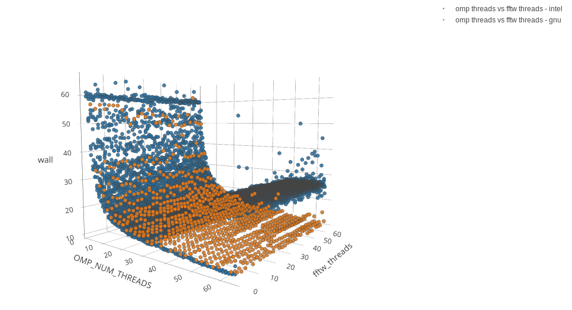
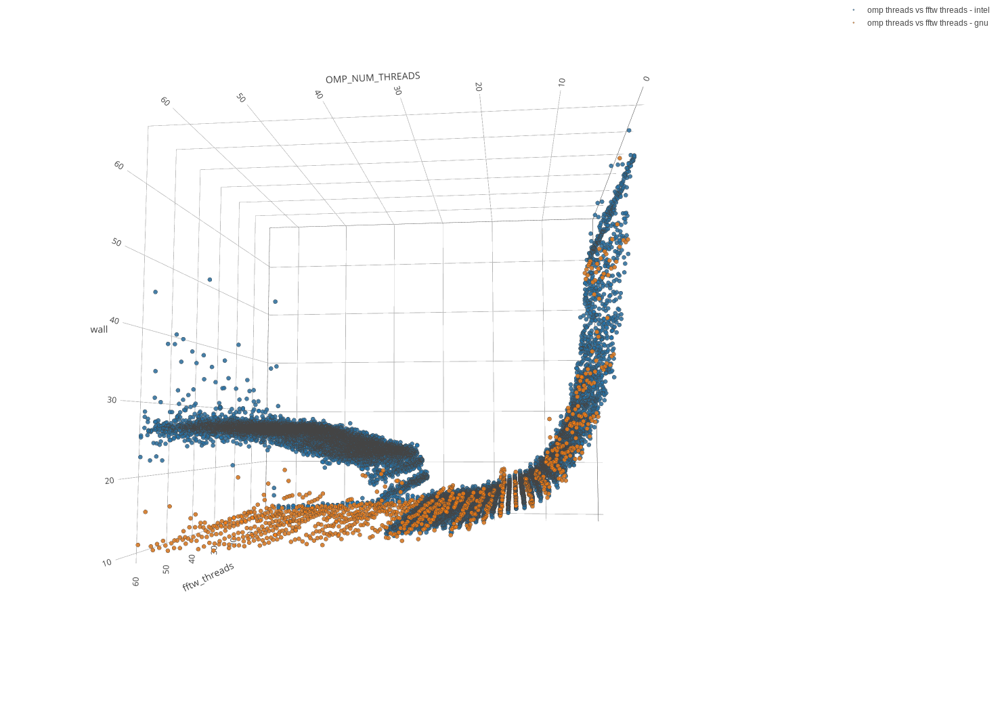

# Building FastSim on Koios, and Intel vs GNU thread scaling

[FastSim](https://github.com/vrastil/FastSim) is a cosmology code built on FFTW, GSL and the
CCL and CLASS libraries. Building it on Koios with the GNU toolchain needed two workarounds, and
running it with the Intel and GNU builds showed that the two toolchains scale differently with
the number of threads.

<!-- more -->

!!! note "Written in 2019"
    This post describes Koios in 2019. The modules below (`foss/2019a` and friends) are no
    longer installed, and the build may have changed since. The two workarounds and the scaling
    observation may still be useful.

## Get the code

The repository has submodules, so initialise them after cloning:

```
git clone https://github.com/vrastil/FastSim.git
cd FastSim
git submodule update --init --recursive
```

## Load the modules

GNU toolchain:

```
module load devel/CMake/3.13.3-GCCcore-8.2.0
module load toolchain/foss/2019a
module load devel/Boost/1.70.0-gompi-2019a
module load devel/pkg-config/0.29.2-GCCcore-8.2.0
module load numlib/GSL/2.5-GCC-8.2.0-2.31.1
module load devel/SWIG/4.0.0-foss-2019a-Python-2.7.15
```

## Configure

```
mkdir build
cd build
cmake .. -DFFTW_ROOT=${EBROOTFFTW} -DCMAKE_INSTALL_PREFIX=<install prefix>
```

Add `-DCMAKE_BUILD_TYPE=RelWithDebInfo` for a build with debugging information. CMake
complains twice about FFTW; that is expected at this point.

## Workaround 1: FFTW not found in ANGPOW

The first `make` fails while configuring the bundled ANGPOW library:

```
-- Could NOT find FFTW (missing: FFTW_INCLUDES)
CMake Error: The following variables are used in this project, but they are set to NOTFOUND.
...
-- Configuring incomplete, errors occurred!
```

ANGPOW's CMake cache has no FFTW include path:

```
$ grep FOUND ./src/3party/CCL/ANGPOW/src/ANGPOW-build/CMakeCache.txt
FFTW_INCLUDES:PATH=FFTW_INCLUDES-NOTFOUND
GSL_FOUND:INTERNAL=1
PKG_FFTW_FOUND:INTERNAL=1
```

With the FFTW module loaded, `${EBROOTFFTW}` points to its installation. Write the include
directory into the cache and run `make` again:

```
sed -i "s|FFTW_INCLUDES:PATH=FFTW_INCLUDES-NOTFOUND|FFTW_INCLUDES:PATH=${EBROOTFFTW}/include|" \
    ./src/3party/CCL/ANGPOW/src/ANGPOW-build/CMakeCache.txt
make
```

## Workaround 2: missing CBLAS when linking

ANGPOW now builds, but linking the `FastSim` binary fails:

```
[ 96%] Linking CXX executable FastSim
.../GSL/2.5-GCC-8.2.0-2.31.1/lib/libgsl.so: error: undefined reference to 'cblas_ztrsm'
collect2: error: ld returned 1 exit status
```

GSL needs a CBLAS library, and the link command doesn't name one. In
`src/main/CMakeFiles/FastSim.dir/link.txt`, add `-lgslcblas` right after `-lgsl`, and run
`make` once more. The build then finishes, including the Python bindings (`_fastsim.so`).

Before running FastSim, add its libraries to the library path:

```
export LD_LIBRARY_PATH=<install prefix>/lib:${LD_LIBRARY_PATH}
```

## Thread scaling: Intel vs GNU

FastSim sets the number of OpenMP threads and the number of FFTW threads separately. We ran
it with many combinations of `OMP_NUM_THREADS` and FFTW threads up to 64, with an Intel build
(blue) and with the GNU build (orange). The vertical axis is the wall time.





The Koios nodes then had 32 physical cores with two hardware threads each. The Intel build was
fastest at 32 threads, one per physical core, and got slower above that. The GNU build kept
getting faster up to 64 threads, using the hardware threads too.

The lesson still applies: the best thread count depends on the code and the compiler, not
only on the core count. Measure it for your own code before running large jobs.
