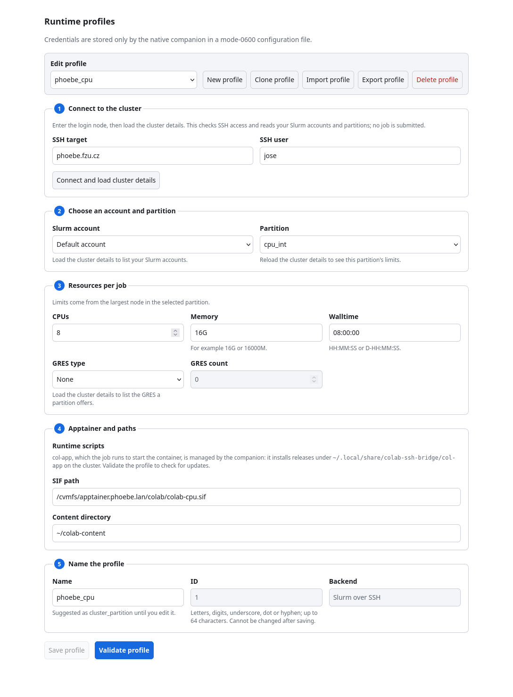
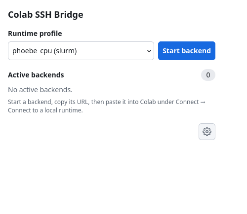

# Google Colab on Phoebe

The **Colab SSH Bridge** Firefox add-on runs the Python kernel of a [Google Colab](https://colab.research.google.com)
notebook on a Phoebe compute node. You keep using Colab in your browser; the code runs in a
Slurm job with the CPUs, memory and GPUs you ask for, and can read your files on Phoebe.

!!! warning "Beta"
    The add-on is new and still changing. It works on Linux only (tested on Ubuntu 24.04 and
    later). Report problems to the cluster administrator.

## How it works

The add-on has two parts: the Firefox extension, and a small **companion** program that Firefox
starts on your computer. When you start a backend, the companion logs in to Phoebe over SSH,
submits a Slurm job that starts a Colab-compatible runtime in an
[Apptainer](https://apptainer.org) container, and connects it to a port on your computer.
Colab then uses that port as a *local runtime*.

* Your SSH key stays in your SSH setup; the add-on stores no passwords or keys.
* The runtime listens only on the compute node itself, and the port on your computer only on
  `127.0.0.1`. The connection URL contains a secret token: don't share it.
* Notebook code runs as your Phoebe user and can read and change your files there. Only run
  notebooks you trust.
* The job uses your Slurm account like any other job. It keeps running when you close Firefox,
  until you stop it or its time limit ends.

## What you need

* Linux with **Python 3.11 or later** (`python3 -V`). Ubuntu 22.04 ships 3.10 and is not supported.
* **Firefox 140 or later**. The snap Firefox that Ubuntu installs by default works.
* A [Phoebe account](../../getting-started/account.md) that you can log in to with an
  [SSH key](../../getting-started/ssh-key.md), without typing a password.

| Download | What it is |
| --- | --- |
| [colab-ssh-bridge-0.2.2.xpi](colab-ssh-bridge-0.2.2.xpi) | the Firefox add-on (step 3) |
| [install.sh](install.sh) | installs the companion (step 2) |
| [phoebe_cpu.yaml](phoebe_cpu.yaml){ download } | a ready Phoebe CPU profile to import (step 4) |
| [uninstall.sh](uninstall.sh) | removes the companion again |

## 1. Check SSH to Phoebe

The companion runs SSH in the background and cannot answer password or passphrase prompts.
This command must print `ok` without asking anything:

```
ssh -o BatchMode=yes phoebe.fzu.cz echo ok
```

If your Phoebe login name differs from the one on your computer, add it to `~/.ssh/config`:

```
Host phoebe.fzu.cz
    User YOUR_PHOEBE_LOGIN
```

If it fails with `Permission denied (publickey)`, [create a key](../../getting-started/ssh-key.md)
and install it. A key with a passphrase works while it is loaded in your SSH agent: the Ubuntu
desktop usually loads it at login; otherwise run `ssh-add` once per session.

## 2. Install the companion

The companion installs into your home directory and needs no `sudo`:

```
curl -fsSL https://hpc.ceico.cz/compute/colab/install.sh | bash
```

It checks Python, downloads the companion, verifies its SHA-256, installs it to
`~/.local/share/colab-ssh-bridge`, and registers it with Firefox in
`~/.mozilla/native-messaging-hosts`. You can read [install.sh](install.sh) first.

## 3. Install the add-on

1. In Firefox, click [colab-ssh-bridge-0.2.2.xpi](colab-ssh-bridge-0.2.2.xpi).
2. Firefox says it prevented the site from asking you to install software. Click
   **Continue to Installation**, then **Add**.
3. The add-on icon appears in the toolbar. If it is hidden, find it under the puzzle-piece menu
   and pin it.

The add-on is signed by Mozilla and updates itself, like add-ons from the Firefox add-on store.

**Snap Firefox:** the snap Firefox runs in a sandbox and asks Ubuntu for permission to start
the companion. The first time the add-on connects, Ubuntu asks whether Firefox may start
*Colab SSH Bridge*. Choose **Allow**; Ubuntu remembers the answer. If you clicked *Deny*, clear
the stored answer and restart Firefox:

```
gdbus call --session --dest org.freedesktop.impl.portal.PermissionStore \
  --object-path /org/freedesktop/impl/portal/PermissionStore \
  --method org.freedesktop.impl.portal.PermissionStore.DeletePermission \
  webextensions cz.ceico.colab_ssh_bridge snap.firefox
```

## 4. Create a Phoebe profile

A profile says where and how large a job to run. Open the profile editor with the gear button in
the add-on's toolbar popup, or in `about:addons` → Colab SSH Bridge → Preferences.

1. Download [phoebe_cpu.yaml](phoebe_cpu.yaml){ download }, click **Import profile** and choose
   it. It asks for 8 CPUs, 16 GB and 8 hours in the `cpu_int` partition.
2. Enter your Phoebe login in **SSH user**, or leave it empty if `~/.ssh/config` sets it.
3. Click **Connect and load cluster details**. On first contact, compare the host key
   fingerprint with a trusted one before you click **Trust and connect**.
4. Click **Validate profile**. If it reports that col-app is missing, click
   **Install latest col-app**: this puts the small runtime scripts into your Phoebe home.
   Validation submits no job.
5. Click **Save profile**.

For GPU work, choose the `rocky10` partition and select a **GRES type** such as `gpu:a100`; the
editor shows what the partition offers and refuses values no node can provide. See
[GPU jobs](../gpu-jobs.md) for the GPU partitions and limits.

{ style="width:70%" }

## 5. Start a backend and connect Colab

1. Click the add-on icon in the toolbar, select your profile, and click **Start backend**.
2. The row shows the Slurm job waiting in the queue, then the runtime starting. That can take a
   few minutes.
3. When the row is ready, click its copy button to put the connection URL on the clipboard.
4. In Colab, open **Connect** (top right) → **Connect to a local runtime**, paste the URL, and
   click **Connect**.

{ style="width:40%" }

The job keeps running when you close Firefox and reattaches when you open it again. When you are
done, click **Stop** on the row so the allocation is freed for others; otherwise it runs until
its time limit.

## Troubleshooting

| Symptom | Fix |
| --- | --- |
| The popup asks you to install the companion | Run the command from step 2, then click **Retry** in the popup. |
| The popup keeps waiting for the companion | Snap Firefox was denied permission. Clear it as shown in step 3, then restart Firefox. |
| `Permission denied (publickey)` when connecting | Repeat step 1. If the key has a passphrase, run `ssh-add`. |
| The job stays queued | The partition is full; see [why a job is waiting](../troubleshooting.md). |
| Anything else | Open the Browser Console with ++ctrl+shift+j++; companion messages appear there. Send those lines to the cluster administrator. |

## Uninstall

Stop any running backend first, or cancel its job on Phoebe with `scancel`. Remove the add-on
in `about:addons`, then remove the companion:

```
curl -fsSL https://hpc.ceico.cz/compute/colab/uninstall.sh | bash
```

This disables the companion and moves its files aside so they can be restored. Your profiles in
`~/.config/colab-ssh-bridge` are kept; delete that directory to remove them too.
